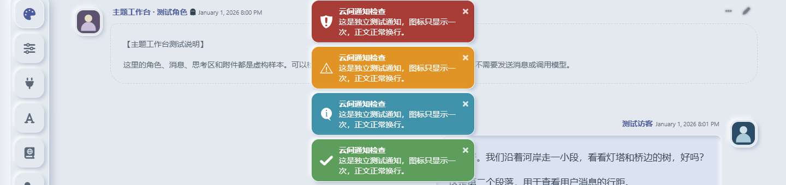

# 云间 · Cloud Correspondence

SillyTavern 新拟物主题与配套外观扩展。浅色软气泡、石墨深色、可调配色和阅读字号，桌面侧边按钮轨，手机折叠菜单。


## 安装

需要 **SillyTavern 1.19.0 或更高版本**；实际验证版本为 1.19.0。新用户需要安装扩展和导入主题这两步。

1. 打开酒馆「扩展 → 安装扩展」，粘贴仓库地址并安装：

   ```text
   https://github.com/demilich1117/cloud-correspondence
   ```

2. [下载云间主题 JSON](https://raw.githubusercontent.com/demilich1117/cloud-correspondence/main/themes/cloud-correspondence.json)，在酒馆「用户设置 → UI 主题」导入并选中。如果浏览器打开的是文本，将文件另存为 `.json` 后导入。
3. 刷新酒馆，点击菜单里的调色盘「云间外观」。手机点击顶部「菜单」可展开所有原生入口。

扩展在云间主题启用时显示；切换其他主题会隐藏入口并撤销自己的临时样式。只导入主题也能使用默认浅色，配套扩展提供明暗切换、调色和手机折叠菜单。

安装不需要 Node.js、npm、构建命令或修改酒馆核心。

## 已安装旧版

- **更新主题并保留个人外观设置：**打开 [theme.css](themes/theme.css)，复制完整内容替换酒馆「自定义 CSS」，使用酒馆原生主题保存入口保存。已有页面宽度、字号比例和其他外观选项保留。
- **完整导入主题 JSON：**适合新安装或希望采用发行默认值的用户，会应用 JSON 中保存的原生外观设置。
- **更新扩展：**Git 安装的用户在酒馆扩展管理里点击更新，然后刷新。主题 CSS 是单独保存的，扩展更新不会自动覆盖它。
- **从手动解压版迁移：**备份旧 `cloud-correspondence` 文件夹，再把它移出原扩展目录，然后使用上面的 GitHub 地址安装。否则酒馆会提示目录已存在。不要同时保留用户级和全局两份副本；无需重置酒馆设置，配套外观配置仍使用原来的 `cloudCorrespondence` 键。

## 外观选项

- 浅色、深色或跟随系统，明暗各自记忆配色。
- 十套配色预设，可编辑底色和强调色，正文颜色与阴影随底色计算。
- 凹凸强度、正文字号、气泡圆角，以及撤销和恢复当前模式。
- 原生「页面宽度」调整桌面阅读宽度。短用户回复按内容收缩并靠右，手机正文利用可用屏宽。

## 1.0.2 修复

- 通知弹窗不再重复铺满符号，恢复原生单枚图标、文字和关闭按钮。
- 移除角色消息的 1000px 固定上限，正文宽度随原生页面宽度滑块变化。
- 配套扩展功能与 1.0.1 相同，本版同步版本号并补充仓库主页。



[查看手机截图](docs/screenshots/mobile.png) · [更新记录](CHANGELOG.md) · [验证范围](docs/validation.md)

## 兼容与数据

实际验证：SillyTavern 1.19.0 / `06bde939f`、Chromium，320px 至 2442px CSS 视口、浅深色模式。更高版本需要按宿主变化复核，不保证所有版本和第三方扩展组合。

扩展只保存自己的外观配置，不读取聊天正文，不修改角色卡，不调用模型，不发送遥测或外部网络请求。主题无外链图片或字体。消息 iframe 内部的独立样式不由本主题控制。

## 开发

仓库根目录就是酒馆可安装的前端扩展。`manifest.json` 声明 `index.js` 和 `style.css`，`palette.mjs` 提供配色函数。主题导入文件位于 `themes/`，无需打包。

开发检查（需要 Node.js）：

```sh
npm run check
npm test
```

本仓库暂未指定开源许可证。
