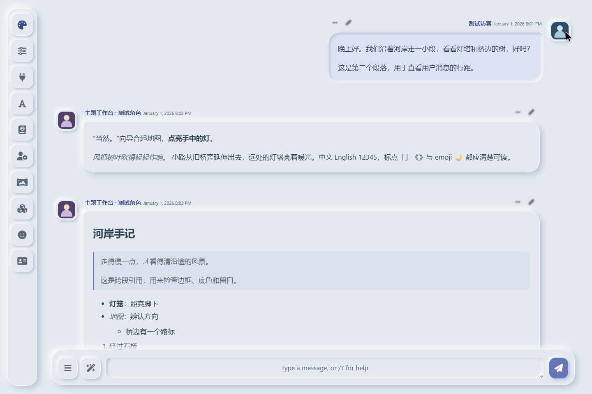
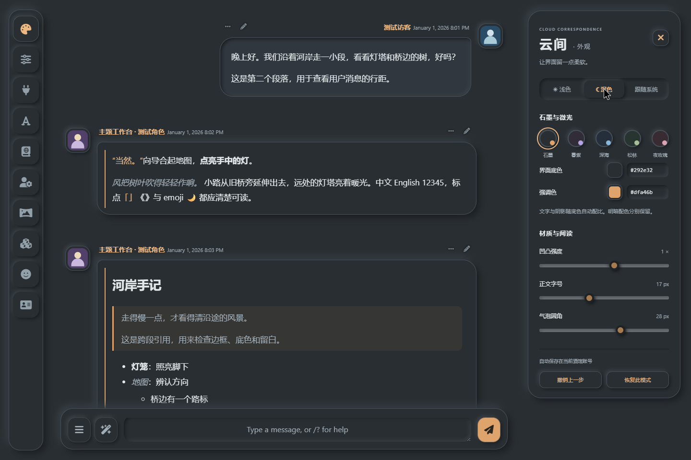
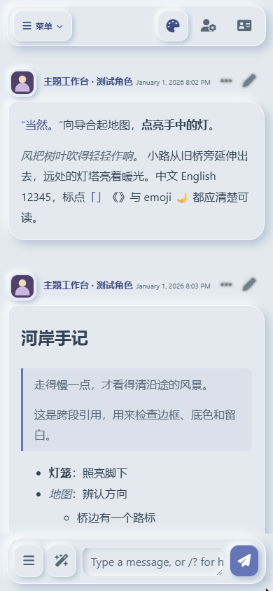

# 云间 1.0.3 · 实际效果

截图与短视频来自独立 SillyTavern 1.19.0 的虚构测试对话，使用真实消息、菜单与外观扩展。手机画面为 390×844 浏览器视口。

## 浅色阅读

柔软气泡与加深的强调文字；用户回复靠右，角色正文随原生页面宽度变化。

## 深色与调色

浅深色分别记忆配色，面板里可以继续调整字号、圆角和凹凸强度。

## 手机菜单

保留常用入口，点击「菜单」展开全部功能。

[观看或下载短视频](https://github.com/demilich1117/cloud-correspondence/releases/download/v1.0.3/cloud-correspondence-demo.mp4) · [Discord 发帖文字](discord-post.md)

想做自己的版本，可用 [酒馆主题工作台](https://github.com/demilich1117/tavern-theme-studio) 继续拾取和微调。工作台的 [真实演示](https://github.com/demilich1117/tavern-theme-studio/blob/master/docs/showcase.md) 使用同一套主题，便于对照整个制作流程。
